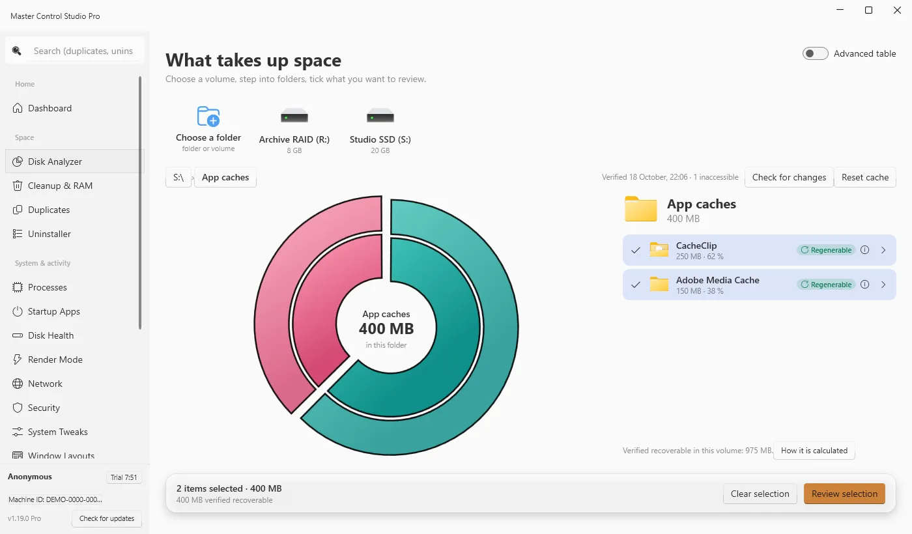
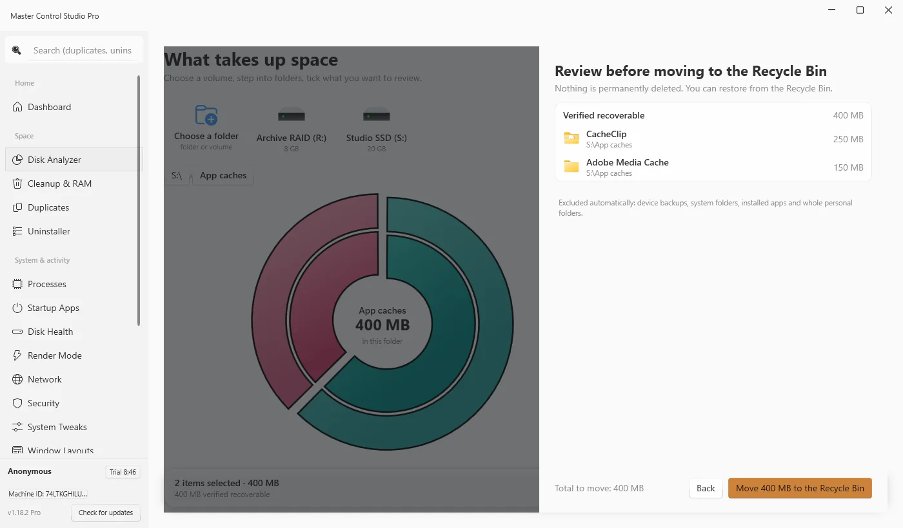
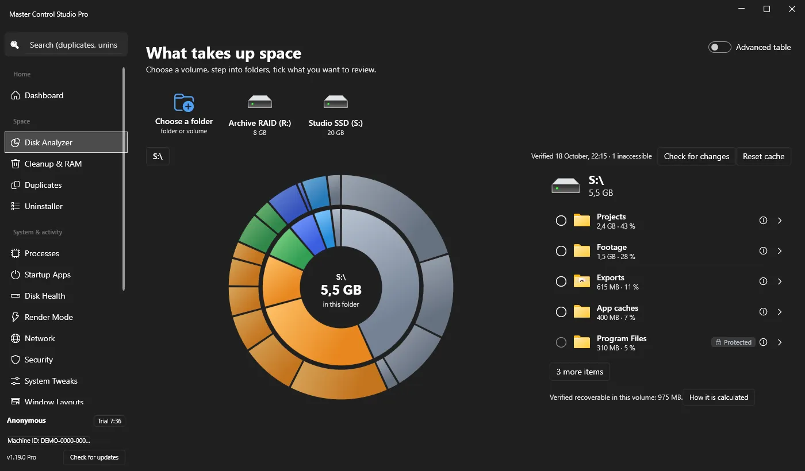
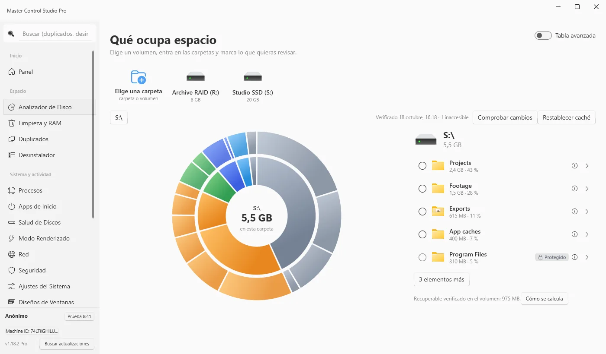

# Master Control Studio Pro — Windows

See what takes up space on your drives, review it, and move it to the Recycle Bin **recoverably** — plus the rest of an editing workstation's toolkit: reversible Render Mode, cleanup, duplicates, cloud accounts, security checks. Native WPF (.NET 8), English / Română / Español.

**Download:** [gordas.dev/mac-master-control-pro](https://gordas.dev/mac-master-control-pro/) · [Releases](https://github.com/gordasgdc/mac-master-control-pro-win/releases/latest) · macOS edition: [mac-master-control-pro](https://github.com/gordasgdc/mac-master-control-pro)


<table><tr>
<td></td>
<td></td>
</tr><tr>
<td></td>
<td></td>
</tr></table>

*Screenshots are from the real app running in a Windows 11 virtual machine, on demonstration volumes with synthetic data.*

## What it does

- **Disk Analyzer** — proportional radial chart, short list with details on demand, shared selection, review sheet, move to the Recycle Bin (never a permanent delete). The recoverable total is computed from verified rules with no double counting; items without a verified rule are never counted and need explicit confirmation. Detects growth and in-place rewrites at any depth, cancels instantly, never reuses a stale cache for a disconnected or replaced volume.
- **Render Mode** — pauses Windows Search and File History while you render (and raises DaVinci Resolve's priority); the exact previous state is saved and restored.
- **Cleanup & RAM**, **Duplicates** (SHA-256 content comparison), **Cloud Manager** (rclone + WinFsp), **Security checks** (Defender, firewall, BitLocker, Secure Boot), **Network tuning**, **DaVinci Resolve** helpers, **Window layouts**.
- **Diagnostics** — local, redacted log and an export without passwords, keys or file contents; nothing is sent automatically. SMTP password protected with DPAPI.

## Access, licence and limits

- The app runs in **Demo** without an account: 10 minutes of active use, then the next session 48 hours after it ends. Ending the trial never deletes your settings, accounts or data.
- The official edition takes a signed licence in return for a donation (offers are a signed list read inside the app: 5 € / 1 month, 10 € / 3 months, 15 € / 1 year). **One licence = one computer** (Windows *or* Mac); moving it means deactivating the old activation (or an administrator reset) and activating the new one.
- The community edition built from this repository has no activation and stays in Demo.
- Known limits: hard links are counted per link; small files are listed individually (macOS groups them); cloud-only files are not downloaded to be measured; on Windows ARM the x64 build runs through emulation.

## Build

```powershell
dotnet build src/MacMasterControlPro.Client -c Release
dotnet publish src/MacMasterControlPro.Client -c Release -r win-x64 --self-contained -o publish
# installer: Inno Setup, installer.iss
```

Set `MCSP_BUILD_ROOT` to redirect `bin`/`obj` to another drive. Requires Windows 10/11 and the .NET 8 SDK.

## Licence

Source code under the MIT licence (see `LICENSE`). Dependencies, name, logo and identity assets are not covered by MIT: see `THIRD_PARTY_NOTICES.md`. The official edition activates through GDC rights (donation) without restricting MIT rights over the source.
